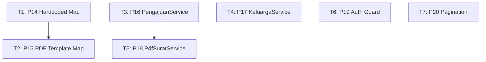

# Task Plan: Perbaikan Bug Fase 2 — Refactoring & Maintainability (P3)

> **Status:** Rencana (belum dieksekusi)  
> **Target:** 7 bug tersisa dari `docs/analisa-error.md` (P3 — Risiko Desain)  
> **Estimasi Total:** ~8.5 jam

---

## Daftar Bug Tersisa (P3)

| # | Bug | Kategori | File Terkait |
|---|---|---|---|
| **14** | Map hardcoded slug↔id di 2 tempat | Maintainability | `PengajuanSuratController::create()`, `SuratMasukController::setujuiSurat()` |
| **15** | Mapping template PDF via `stripos(nama_surat)` | Maintainability | `PengajuanSuratController::cetakSurat()`, `SuratMasukController::cetakSurat()` |
| **16** | `store()` pengajuan pakai `$request->except()` tanpa whitelist | Security/Code Quality | `PengajuanSuratController::store()` |
| **17** | `update($request->all())` di `Admin\KeluargaController` | Code Quality | `Admin\KeluargaController::update()` |
| **18** | Duplikasi logika cetak PDF (warga & admin) | DRY/Maintainability | 2 controller + view PDF |
| **19** | `Auth::user()` tanpa guard eksplisit | Security | `DashboardWargaController`, `PengaduanController` |
| **20** | Tidak ada pagination di riwayat pengajuan warga | Performance | `RiwayatPengajuanController::index()` |

---

## Desain Detail per Task

---

### T1: P14 — Hapus Hardcoded Map, Pakai `kode_surat` dari DB

#### Masalah
Dua array hardcoded duplikat:
```php
// PengajuanSuratController::create() — line 27-41
$jenis_id_map = [
    'surat-sktm' => 1, 'surat-beasiswa' => 2, ... 'surat-perubahandata' => 13
];

// SuratMasukController::setujuiSurat() — line 62-76
$kode_surat_map = [
    1 => 'SKTM', 2 => 'BEAS', ... 13 => 'UBDT'
];
```

#### Solusi
Tabel `jenis_surat` sudah punya kolom `kode_surat` (diisi: `SKTM`, `BEAS`, `IUMK`, `DOMI`, `PHSL`, `BLMK`, `HILG`, `KMAT`, `PNTR`, `JAMK`, `IZRM`, `PNDH`, `UBDT`).

**Perubahan:**

1. **`PengajuanSuratController::create()`** — resolve via DB:
   ```php
   $jenisSurat = JenisSurat::where('kode_surat', $slugToKodeMap[$slug] ?? null)->first();
   // Atau lebih baik: route pakai {jenis_surat_id} langsung, slug hanya untuk display
   ```

2. **`SuratMasukController::setujuiSurat()`** — pakai relasi:
   ```php
   $kodeSurat = $pengajuan->jenisSurat->kode_surat; // 'SKTM'
   $nomorSurat = $request->no_urut . '/' . $kodeSurat . '/' . $bulanRomawi . '/' . $tahun;
   ```

#### File
- `app/Http/Controllers/Penduduk/PengajuanSuratController.php` (method `create`)
- `app/Http/Controllers/Admin/SuratMasukController.php` (method `setujuiSurat`)

#### Estimasi: 1 jam

---

### T2: P15 — Template PDF Pakai `kode_surat` Bukan `stripos`

#### Masalah
Dua controller `cetakSurat()` pakai `stripos($namaSurat, '...')` yang rapuh:
```php
if (stripos($namaSurat, 'Beasiswa') !== false) { $view = 'pdf-rekomendasi-beasiswa'; }
elseif (stripos($namaSurat, 'Penghasilan') !== false) { $view = 'pdf-penghasilan'; }
// ...
```

#### Solusi
Mapping template via `kode_surat` (atau `jenis_surat_id`):

```php
// Di Service/Controller
$kodeSurat = $surat->jenisSurat->kode_surat; // 'SKTM', 'BEAS', dst.

$templateMap = [
    'SKTM'     => 'admin.surat.pdf-sktm',
    'BEAS'     => 'admin.surat.pdf-rekomendasi-beasiswa',
    'IUMK'     => 'admin.surat.pdf-iumk',
    'DOMI'     => 'admin.surat.pdf-domisili',
    'PHSL'     => 'admin.surat.pdf-penghasilan',
    'BLMK'     => 'admin.surat.pdf-belummenikah',
    'HILG'     => 'admin.surat.pdf-kehilangan',
    'KMAT'     => 'admin.surat.pdf-kematian',
    'PNTR'     => 'admin.surat.pdf-pengantar',
    'JAMK'     => 'admin.surat.pdf-jamkes',
    'IZRM'     => 'admin.surat.pdf-keramaian',
    'PNDH'     => 'admin.surat.pdf-pindah',
    'UBDT'     => 'admin.surat.pdf-perubahandata',
];

$view = $templateMap[$kodeSurat] ?? 'admin.surat.pdf-umum';
```

#### File
- `app/Http/Controllers/Penduduk/PengajuanSuratController.php` (method `cetakSurat`)
- `app/Http/Controllers/Admin/SuratMasukController.php` (method `cetakSurat`)

**Catatan:** Akan digabung ke `PdfSuratService` di T5.

#### Estimasi: 1 jam (standalone) / digabung T5

---

### T3: P16 — Whitelist `store()` + Extract ke `PengajuanService`

#### Masalah
`PengajuanSuratController::store()` pakai `$request->except()` → mass-assignment ke tabel detail.

#### Solusi: `PengajuanService` + Whitelist

**Struktur Baru:**
```
app/Services/
├── PengajuanService.php
├── KeluargaService.php
└── PdfSuratService.php
```

**`PengajuanService.php`:**
```php
class PengajuanService
{
    // Field whitelist per jenis surat
    protected $detailFields = [
        'surat-sktm'        => ['tujuan_sktm', 'jumlah_tanggungan', 'keterangan_aset', 'total_penghasilan_keluarga'],
        'surat-beasiswa'    => ['nama_institusi', 'tingkat_pendidikan', 'nama_penerima_beasiswa'],
        // ... 13 jenis
    ];

    public function createPengajuan(Warga $pemohon, array $validated): PengajuanSurat
    {
        DB::beginTransaction();
        try {
            // 1. Header
            $pengajuan = PengajuanSurat::create([
                'warga_nik' => $validated['warga_nik_pemohon'],
                'jenis_surat_id' => $validated['jenis_surat_id'],
                'status' => 'Diajukan',
                'metode_ambil' => $validated['metode_ambil'],
            ]);

            // 2. Detail
            $slug = $validated['slug'];
            $fields = $this->detailFields[$slug] ?? [];
            $detailData = array_intersect_key($validated, array_flip($fields));
            $detailData['pengajuan_id'] = $pengajuan->id;
            
            $tableName = str_replace('-', '_', $slug) . '_detail';
            DB::table($tableName)->insert($detailData);

            DB::commit();
            return $pengajuan;
        } catch (\Exception $e) {
            DB::rollback();
            throw $e;
        }
    }
}
```

**Controller menjadi tipis:**
```php
public function store(Request $request)
{
    $validated = $request->validate([
        'warga_nik_pemohon' => 'required',
        'jenis_surat_id' => 'required',
        'metode_ambil' => 'required|in:kantor,mandiri',
        'slug' => 'required',
        // ... field dinamis tervalidasi per slug
    ]);

    $pengajuan = app(PengajuanService::class)->createPengajuan(
        Auth::guard('warga')->user(), $validated
    );

    return redirect()->route('dashboard.warga')->with('success', 'Pengajuan berhasil dikirim.');
}
```

#### File
- **Baru:** `app/Services/PengajuanService.php`
- **Ubah:** `app/Http/Controllers/Penduduk/PengajuanSuratController.php` (method `store`)

#### Estimasi: 2 jam

---

### T4: P17 — Hapus `$request->all()`, Extract ke `KeluargaService`

#### Masalah
`Admin\KeluargaController::update()` pakai `$keluarga->update($request->all())` — tidak eksplisit.

#### Solusi: `KeluargaService`

**`KeluargaService.php`:**
```php
class KeluargaService
{
    public function create(array $data): Keluarga
    {
        return Keluarga::create([
            'no_kk' => $data['no_kk'],
            'nama_kepala_keluarga' => $data['nama_kepala_keluarga'],
        ]);
    }

    public function update(Keluarga $keluarga, array $data): Keluarga
    {
        // no_kk immutable — hanya update nama
        $keluarga->update([
            'nama_kepala_keluarga' => $data['nama_kepala_keluarga'],
        ]);
        return $keluarga;
    }

    public function delete(Keluarga $keluarga): bool
    {
        return $keluarga->delete();
    }
}
```

**Controller:**
```php
public function store(Request $request)
{
    $validated = $request->validate([
        'no_kk' => 'required|string|size:16|unique:keluarga,no_kk',
        'nama_kepala_keluarga' => 'required|string|max:150',
    ]);
    app(KeluargaService::class)->create($validated);
    return back()->with('success', '...');
}

public function update(Request $request, $id)
{
    $keluarga = Keluarga::findOrFail($id);
    $validated = $request->validate([
        'nama_kepala_keluarga' => 'required|string|max:150',
    ]);
    app(KeluargaService::class)->update($keluarga, $validated);
    return back()->with('success', '...');
}
```

#### File
- **Baru:** `app/Services/KeluargaService.php`
- **Ubah:** `app/Http/Controllers/Admin/KeluargaController.php` (method `store`, `update`)

#### Estimasi: 1.5 jam

---

### T5: P18 — Extract Logika Cetak PDF ke `PdfSuratService`

#### Masalah
Logika `cetakSurat` (mapping template, load relasi, DomPDF) terduplikasi di 2 controller.

#### Solusi: `PdfSuratService` (Singleton/Service)

**`PdfSuratService.php`:**
```php
class PdfSuratService
{
    protected $templateMap = [
        'SKTM'     => 'admin.surat.pdf-sktm',
        'BEAS'     => 'admin.surat.pdf-rekomendasi-beasiswa',
        'IUMK'     => 'admin.surat.pdf-iumk',
        'DOMI'     => 'admin.surat.pdf-domisili',
        'PHSL'     => 'admin.surat.pdf-penghasilan',
        'BLMK'     => 'admin.surat.pdf-belummenikah',
        'HILG'     => 'admin.surat.pdf-kehilangan',
        'KMAT'     => 'admin.surat.pdf-kematian',
        'PNTR'     => 'admin.surat.pdf-pengantar',
        'JAMK'     => 'admin.surat.pdf-jamkes',
        'IZRM'     => 'admin.surat.pdf-keramaian',
        'PNDH'     => 'admin.surat.pdf-pindah',
        'UBDT'     => 'admin.surat.pdf-perubahandata',
    ];

    protected $relations = [
        'warga', 'jenisSurat',
        'penghasilanDetail', 'sktmDetail', 'beasiswaDetail', 'iumkDetail',
        'belumMenikahDetail', 'izinKeramaianDetail', 'kehilanganDokDetail',
        'pengantarDetail', 'pengantarKtpDetail', 'jamkesDetail',
        'kematianDetail', 'pindahDetail', 'perubahanDataDetail',
    ];

    public function generate(PengajuanSurat $surat, string $filename = null): \Illuminate\Http\Response
    {
        // Load relasi
        $surat->load($this->relations);

        // Resolve template via kode_surat
        $kodeSurat = $surat->jenisSurat->kode_surat ?? 'UMUM';
        $view = $this->templateMap[$kodeSurat] ?? 'admin.surat.pdf-umum';

        $pdf = \Barryvdh\DomPDF\Facade\Pdf::loadView($view, compact('surat'));
        $pdf->setPaper('letter', 'portrait');

        $name = $filename ?? 'Surat_' . $surat->jenisSurat->nama_surat . '_' . $surat->warga->nama_lengkap . '.pdf';
        return $pdf->stream($name);
    }

    public function canPrint(Warga $warga, PengajuanSurat $surat): bool
    {
        // Access control logic (owner check, status check)
        return $surat->warga_nik === $warga->nik && $surat->status === 'Disetujui';
    }
}
```

**Controller tipis:**
```php
// Warga controller
public function cetakSurat($id)
{
    $surat = PengajuanSurat::findOrFail($id);
    $warga = Auth::guard('warga')->user();
    
    if (!app(PdfSuratService::class)->canPrint($warga, $surat)) {
        abort(403);
    }
    return app(PdfSuratService::class)->generate($surat);
}

// Admin controller
public function cetakSurat($id)
{
    $surat = PengajuanSurat::findOrFail($id);
    // Admin bisa cetak semua yang Disetujui
    if ($surat->status !== 'Disetujui') {
        return back()->with('error', 'Surat belum disetujui.');
    }
    return app(PdfSuratService::class)->generate($surat);
}
```

#### File
- **Baru:** `app/Services/PdfSuratService.php`
- **Ubah:** `PengajuanSuratController::cetakSurat()`, `SuratMasukController::cetakSurat()`

#### Estimasi: 2 jam

---

### T6: P19 — Ganti `Auth::user()` → `Auth::guard('warga')->user()`

#### Masalah
2 controller pakai `Auth::user()` tanpa guard eksplisit:
- `DashboardWargaController::index()` line 16
- `PengaduanController::index()` line 14

#### Solusi
```php
// Sebelum
$user = Auth::user();

// Sesudah
$user = Auth::guard('warga')->user();
```

#### File
- `app/Http/Controllers/Penduduk/DashboardWargaController.php`
- `app/Http/Controllers/Penduduk/PengaduanController.php`

#### Estimasi: 0.5 jam

---

### T7: P20 — Tambah Pagination Riwayat Pengajuan

#### Masalah
`RiwayatPengajuanController::index()` pakai `->get()` (ambil semua).

#### Solusi
```php
// Sebelum
$riwayat = PengajuanSurat::with(['jenisSurat', 'warga'])
    ->whereIn('warga_nik', $list_nik)
    ->orderBy('created_at', 'desc')
    ->get();

// Sesudah
$riwayat = PengajuanSurat::with(['jenisSurat', 'warga'])
    ->whereIn('warga_nik', $list_nik)
    ->orderBy('created_at', 'desc')
    ->paginate(10)->withQueryString();
```

View: tambah `{{ $riwayat->links() }}` di `warga/riwayat.blade.php`.

#### File
- `app/Http/Controllers/Penduduk/RiwayatPengajuanController.php`
- `resources/views/warga/riwayat.blade.php`

#### Estimasi: 0.5 jam

---

## Urutan Eksekusi & Dependensi



**Urutan eksekusi disarankan:**
1. **T1** (foundation: `kode_surat` di DB)
2. **T2** (pakai `kode_surat` untuk template)
3. **T3** (service pengajuan — standalone)
4. **T4** (service keluarga — standalone)
5. **T5** (pakai T1+T3, extract PDF logic)
6. **T6** (quick win)
7. **T7** (quick win)

---

## Total Estimasi Waktu

| Task | Jam | Ketergantungan |
|---|---|---|
| T1: P14 Hardcoded Map | 1.0 | — |
| T2: P15 PDF Template | 1.0 | T1 |
| T3: P16 PengajuanService | 2.0 | — |
| T4: P17 KeluargaService | 1.5 | — |
| T5: P18 PdfSuratService | 2.0 | T1, T3 |
| T6: P19 Auth Guard | 0.5 | — |
| T7: P20 Pagination | 0.5 | — |
| **Total** | **8.5 jam** | |

---

## Acceptance Criteria (Definition of Done)

| Task | Kriteria Verifikasi |
|---|---|
| **T1** | Tidak ada array `$jenis_id_map` / `$kode_surat_map` di controller; `setujuiSurat()` pakai `$pengajuan->jenisSurat->kode_surat` |
| **T2** | `cetakSurat` resolve template via `$surat->jenisSurat->kode_surat` map; hapus semua `stripos($namaSurat, ...)` |
| **T3** | `store()` pakai whitelist `$request->only([...])`; logika pindah ke `PengajuanService`; controller < 30 baris |
| **T4** | `Admin\KeluargaController` pakai `KeluargaService`; `$request->all()` dihapus; no_kk immutable |
| **T5** | 2 controller `cetakSurat` memanggil `PdfSuratService::generate($surat)`; logic mapping/relasi di Service |
| **T6** | 2 controller pakai `Auth::guard('warga')->user()` eksplisit |
| **T7** | `RiwayatPengajuanController` return `paginate(10)`; view render pagination links |

---

## Risiko & Mitigasi

| Risiko | Mitigasi |
|---|---|
| T1/T2: Data `kode_surat` di DB tidak lengkap/salah | Cek seeder/migrasi `jenis_surat` sebelum eksekusi; pastikan 13 record ada `kode_surat` |
| T3/T4: Service class tidak ter-load otomatis | Register di `bootstrap/app.php` atau pakai `app()` helper; Laravel auto-discover service di `app/Services` |
| T5: Relasi load terlalu banyak (N+1) | Pakai `$surat->load($relations)` array eksplisit; test query count |
| Breaking change route | T1 butuh route update kalau ganti slug→id; cek route `pengajuan.create` |

---

## Catatan Implementasi

1. **Pint** — Jalankan `vendor/bin/pint --dirty` setelah setiap file baru/diubah
2. **Test** — Tambah Pest feature test minimal untuk service baru (opsional tapi disarankan)
3. **Migration** — Tidak butuh migration baru (kolom `kode_surat` sudah ada)
4. **Rollback plan** — Simpan backup controller sebelum refactor; gunakan git commit per task

---

**Penulis:** Task Planner  
**Tanggal:** 2026-08-22  
**File:** `docs/bug-fix-plan-phase2.md`