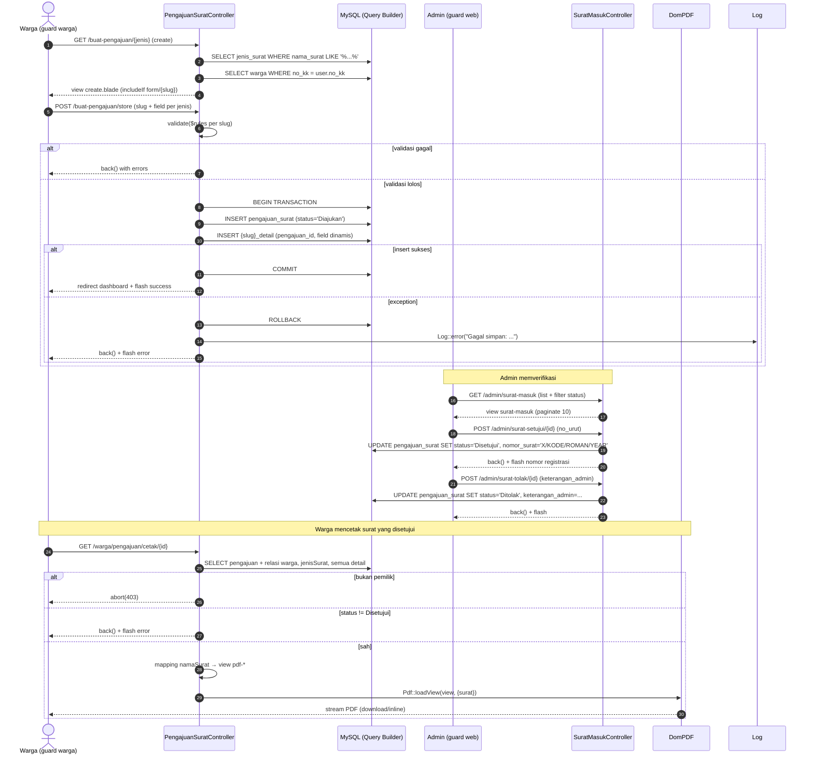
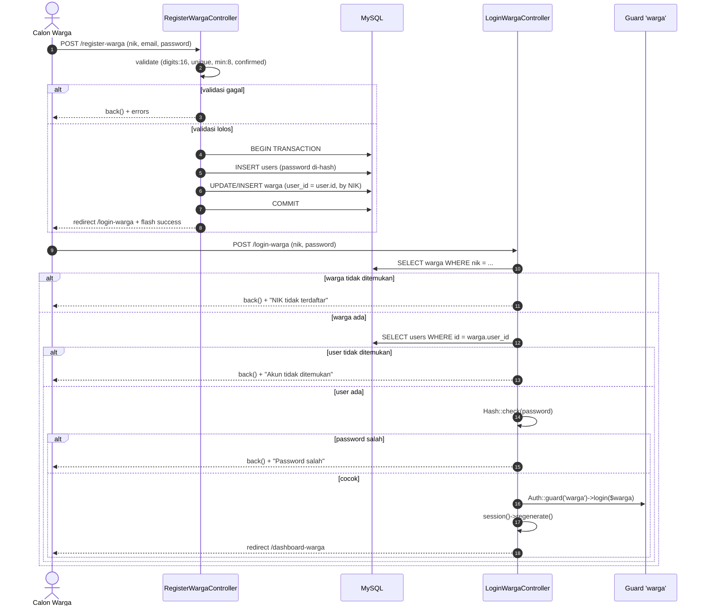
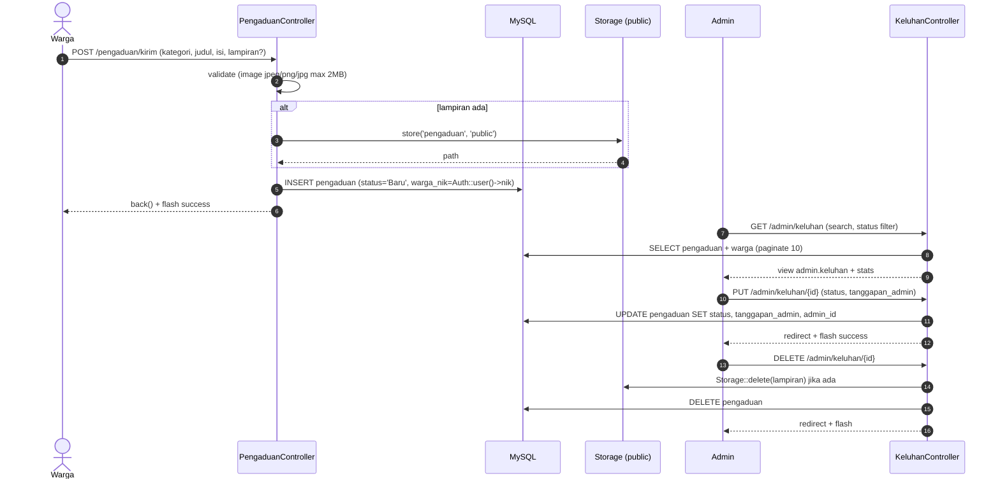

# Blueprint Alur Kerja Aplikasi — Sades Krawangsari

> Dokumen ini adalah hasil reverse-engineering dari codebase untuk dijadikan **template implementasi** bagi fitur serupa di masa depan. Dibuat dengan tingkat detail **Implementation-Ready** (kode dapat langsung disalin).

---

## 1. Hasil Deteksi Arsitektur

| Aspek | Temuan |
|---|---|
| **Framework** | Laravel 13 (PHP 8.3), monolitik, session-based |
| **Entry point** | Web (controller actions), 1 endpoint AJAX/JSON (`show` surat & penduduk) |
| **Persistence** | SQL Database (MySQL) — Eloquent ORM + Query Builder `DB::table()` |
| **Arsitektur** | MVC / Layered sederhana: `Route → Controller → Model/DB → Blade View` (tanpa service layer terpisah) |
| **Auth** | Dual guard: `web` (admin/kades) + `warga` (penduduk via NIK), provider `users` & `warga` |
| **PDF** | `barryvdh/laravel-dompdf` dengan template Blade |
| **Export** | `maatwebsite/excel` untuk ekspor data penduduk |
| **Queue/Event/Job** | Tidak digunakan (hanya migrasi default) |
| **Testing** | Pest terpasang, tetapi `tests/` hanya berisi placeholder (`ExampleTest`) |

**Ringkasan pola arsitektur per lapisan:**

- **Routing** — dikelompokkan per role di `routes/web.php` dengan middleware `guest`, `auth:warga`, dan `auth` + `role:admin,kades`.
- **Controller** — "fat controller": validasi inline, transaksi DB, dan logika bisnis semua di method controller.
- **Model** — model "tipis": hanya `$table`, `$fillable`, `$primaryKey` custom, dan relasi.
- **View** — Blade dengan layout terpisah (`layouts/app-warga`, `layouts/app-admin`), partial form per jenis surat.

---

## 2. Workflow 1 — Pengajuan Surat (End-to-End)

### 2.1 Overview

| Item | Detail |
|---|---|
| **Nama** | Pengajuan Surat Keterangan Desa (13 jenis surat) |
| **Tujuan bisnis** | Warga mengajukan surat keterangan secara online; admin memverifikasi, memberi nomor registrasi, dan warga mencetak sendiri atau mengambil di kantor |
| **Pemicu** | Warga login → klik `Buat Pengajuan` → pilih jenis surat → submit form |
| **Status lifecycle** | `Diajukan` → (opsional `Diproses`/update manual) → `Disetujui` atau `Ditolak` |
| **File terlibat** | `routes/web.php`, `Penduduk\PengajuanSuratController`, `Admin\SuratMasukController`, `Admin\SuratArsipController`, `Penduduk\RiwayatPengajuanController`, model `PengajuanSurat`, `JenisSurat`, 13× model `Surat*Detail`, views `warga/pengajuan/*`, `admin/surat*`, `admin/surat/pdf-*.blade.php` |

**Tabel route terkait:**

```php
// Warga (guard warga)
Route::get('/buat-pengajuan',                [PengajuanSuratController::class, 'index'])->name('pengajuan.katalog');
Route::get('/buat-pengajuan/{jenis}',        [PengajuanSuratController::class, 'create'])->name('pengajuan.create');
Route::post('/buat-pengajuan/store',         [PengajuanSuratController::class, 'store'])->name('pengajuan.store');
Route::get('/warga/riwayat-pengajuan',       [RiwayatPengajuanController::class, 'index'])->name('riwayat.index');
Route::get('/warga/pengajuan/cetak/{id}',    [PengajuanSuratController::class, 'cetakSurat'])->name('pengajuan.cetak');

// Admin (guard web + role)
Route::get('/admin/surat-masuk',             [SuratMasukController::class, 'index'])->name('admin.surat-masuk');
Route::get('/admin/surat-proses/{id}/{status}', [SuratMasukController::class, 'updateStatus'])->name('admin.surat-proses');
Route::post('/admin/surat-setujui/{id}',     [SuratMasukController::class, 'setujuiSurat'])->name('admin.surat-setujui');
Route::post('/admin/surat-tolak/{id}',       [SuratMasukController::class, 'tolakSurat'])->name('admin.surat-tolak');
Route::get('/admin/surat-detail/{id}',       [SuratMasukController::class, 'show'])->name('admin.surat-detail');
Route::get('/admin/surat-cetak/{id}',        [SuratMasukController::class, 'cetakSurat'])->name('admin.surat-cetak');
Route::get('/admin/surat-arsip',             [SuratArsipController::class, 'index'])->name('admin.surat-arsip');
```

### 2.2 Entry Point — `PengajuanSuratController`

**2.2.1 Katalog & halaman form (`index`, `create`)**

`app/Http/Controllers/Penduduk/PengajuanSuratController.php`:

```php
public function index()
{
    return view('warga.pengajuan.katalog');
}

public function create($jenis)
{
    $slug = $jenis;
    $jenis_surat_nama = str_replace('-', ' ', ucwords($jenis, '-'));

    $surat_info = DB::table('jenis_surat')->where('nama_surat', 'like', '%' . $jenis_surat_nama . '%')->first();

    // Fallback hardcoded: slug → id jenis_surat
    $jenis_id_map = [
        'surat-sktm' => 1, 'surat-beasiswa' => 2, 'surat-iumk' => 3,
        'surat-domisili' => 4, 'surat-penghasilan' => 5, 'surat-belummenikah' => 6,
        'surat-kehilangan' => 7, 'surat-kematian' => 8, 'surat-pengantar' => 9,
        'surat-jamkes' => 10, 'surat-keramaian' => 11, 'surat-pindah' => 12,
        'surat-perubahandata' => 13,
    ];
    $jenis_id = $surat_info ? $surat_info->id : ($jenis_id_map[$slug] ?? null);

    // Daftar anggota keluarga (satu KK) untuk opsi "Surat diajukan untuk"
    $user = Auth::guard('warga')->user();
    $anggota_keluarga = [];
    if ($user->no_kk) {
        $anggota_keluarga = DB::table('warga')->where('no_kk', $user->no_kk)->get();
    }

    return view('warga.pengajuan.create', compact('jenis_surat_nama', 'slug', 'jenis_id', 'anggota_keluarga'));
}
```

**Pola penting:** form dibuat dinamis dengan `@includeIf('warga.pengajuan.form.' . $slug)` di `resources/views/warga/pengajuan/create.blade.php` — setiap jenis surat punya file partial sendiri (`form/surat-sktm.blade.php`, dst.), plus hidden field `slug` dan `jenis_surat_id` yang dikirim ke `store`.

**2.2.2 Penyimpanan (`store`) — validasi per-slug + transaksi**

```php
public function store(Request $request)
{
    // 1. Validasi dasar
    $rules = [
        'warga_nik_pemohon' => 'required',
        'jenis_surat_id' => 'required',
        'metode_ambil' => 'required|in:kantor,mandiri',
    ];

    // 2. Validasi spesifik berdasarkan slug (contoh 2 dari 13 cabang)
    if ($request->slug == 'surat-sktm') {
        $rules += ['tujuan_sktm' => 'required', 'jumlah_tanggungan' => 'required|integer',
                   'keterangan_aset' => 'required', 'total_penghasilan_keluarga' => 'required|numeric'];
    } elseif ($request->slug == 'surat-kematian') {
        $rules += ['nik_yang_meninggal' => 'required|size:16', 'nama_yang_meninggal' => 'required',
                   'tanggal_kematian' => 'required', 'tempat_kematian' => 'required',
                   'penyebab_kematian' => 'required', 'nik_pelapor' => 'required|size:16'];
    }
    // ... 11 cabang slug lainnya

    $request->validate($rules);

    try {
        DB::beginTransaction();

        // 3. Simpan header pengajuan
        $pengajuanId = DB::table('pengajuan_surat')->insertGetId([
            'warga_nik' => $request->warga_nik_pemohon,
            'jenis_surat_id' => $request->jenis_surat_id,
            'status' => 'Diajukan',
            'metode_ambil' => $request->metode_ambil,
            'created_at' => now(),
            'updated_at' => now(),
        ]);

        // 4. Simpan detail — nama tabel dibangun dari slug (contoh: surat_sktm_detail)
        $tableName = str_replace('-', '_', $request->slug) . '_detail';
        $detailData = $request->except(['_token', 'slug', 'jenis_surat_id', 'metode_ambil', 'warga_nik_pemohon']);
        $detailData['pengajuan_id'] = $pengajuanId;
        $detailData['created_at'] = now();
        $detailData['updated_at'] = now();

        DB::table($tableName)->insert($detailData);

        DB::commit();
        return redirect()->route('dashboard.warga')->with('success', 'Pengajuan berhasil dikirim.');
    } catch (\Exception $e) {
        DB::rollback();
        Log::error("Gagal simpan: " . $e->getMessage());
        return back()->with('error', 'Gagal: ' . $e->getMessage())->withInput();
    }
}
```

> **Catatan arsitektur:** pola penyimpanan memakai **Query Builder** (`DB::table`), bukan Eloquent, dengan penamaan tabel detail dinamis. Konsekuensinya, `$fillable` pada model `Surat*Detail` tidak dilindungi mass-assignment di jalur ini.

### 2.3 Data Access — Model & Relasi

**`app/Models/PengajuanSurat.php`** — tabel header:

```php
class PengajuanSurat extends Model
{
    protected $table = 'pengajuan_surat';

    protected $fillable = [
        'nomor_surat', 'warga_nik', 'jenis_surat_id', 'status',
        'metode_ambil', 'keterangan_admin', 'final_path_pdf', 'kode_verifikasi_qr'
    ];

    public function warga()      { return $this->belongsTo(Warga::class, 'warga_nik', 'nik'); }
    public function jenisSurat() { return $this->belongsTo(JenisSurat::class, 'jenis_surat_id', 'id'); }

    // 13 relasi hasOne → tabel detail, contoh:
    public function sktmDetail()          { return $this->hasOne(SuratSktmDetail::class, 'pengajuan_id', 'id'); }
    public function beasiswaDetail()      { return $this->hasOne(SuratBeasiswaDetail::class, 'pengajuan_id', 'id'); }
    // ... dst (belumMenikahDetail, domisiliDetail, iumkDetail, izinKeramaianDetail,
    //          jaminanKesehatanDetail, kehilanganDokDetail, kematianDetail,
    //          pengantarKtpDetail, pengantarDetail, penghasilanDetail,
    //          perubahanDataDetail, pindahDetail)
}
```

**Model detail (contoh `SuratSktmDetail`) — PK = `pengajuan_id`:**

```php
class SuratSktmDetail extends Model
{
    protected $table = 'surat_sktm_detail';
    protected $primaryKey = 'pengajuan_id';
    public $incrementing = false;
    protected $fillable = [
        'pengajuan_id', 'tujuan_sktm', 'jumlah_tanggungan',
        'keterangan_aset', 'total_penghasilan_keluarga'
    ];

    public function pengajuan() { return $this->belongsTo(PengajuanSurat::class, 'pengajuan_id'); }
}
```

### 2.4 Entry Point Admin — `SuratMasukController`

**2.4.1 Daftar surat masuk dengan filter status:**

```php
public function index(Request $request)
{
    $user = Auth::user();
    $query = PengajuanSurat::with(['warga', 'jenisSurat'])->latest();

    if ($request->filled('status')) {
        $query->where('status', $request->status);
    }

    $surat = $query->paginate(10);
    return view('admin.surat-masuk', compact('user', 'surat'));
}
```

**2.4.2 Persetujuan + pembuatan nomor surat (`setujuiSurat`):**

```php
public function setujuiSurat(Request $request, $id)
{
    $request->validate(['no_urut' => 'required|string|max:50']);

    $pengajuan = PengajuanSurat::with('jenisSurat')->findOrFail($id);

    // Mapping id jenis_surat → kode singkatan
    $kode_surat_map = [
        1 => 'SKTM', 2 => 'BEAS', 3 => 'IUMK', 4 => 'DOMI', 5 => 'PHSL',
        6 => 'BLMK', 7 => 'HILG', 8 => 'KMAT', 9 => 'PNTR', 10 => 'JAMK',
        11 => 'IZRM', 12 => 'PNDH', 13 => 'UBDT',
    ];
    $kode_surat = $kode_surat_map[$pengajuan->jenis_surat_id] ?? 'SURAT';

    // Format nomor: 145/SKTM/III/2026
    $romawi = ['', 'I', 'II', 'III', 'IV', 'V', 'VI', 'VII', 'VIII', 'IX', 'X', 'XI', 'XII'];
    $nomorSuratLengkap = $request->no_urut . '/' . $kode_surat . '/' . $romawi[(int) date('n')] . '/' . date('Y');

    $pengajuan->update([
        'status' => 'Disetujui',
        'nomor_surat' => $nomorSuratLengkap,
    ]);

    return back()->with('success', "Surat disetujui dengan Nomor Registrasi: $nomorSuratLengkap");
}
```

**2.4.3 Penolakan dengan alasan:**

```php
public function tolakSurat(Request $request, $id)
{
    $request->validate(['keterangan_admin' => 'required|string']);

    $pengajuan = PengajuanSurat::findOrFail($id);
    $pengajuan->update([
        'status' => 'Ditolak',
        'keterangan_admin' => $request->keterangan_admin,
    ]);

    return back()->with('success', 'Permohonan surat berhasil ditolak beserta alasannya.');
}
```

**2.4.4 Endpoint AJAX (modal tanpa reload):**

```php
public function show($id)
{
    $surat = PengajuanSurat::with(['warga', 'jenisSurat'])->findOrFail($id);

    return response()->json([
        'nama' => $surat->warga->nama_lengkap,
        'nik' => $surat->warga_nik,
        'jenis' => $surat->jenisSurat->nama_surat,
        'tanggal' => $surat->created_at->format('d F Y'),
        'updated' => $surat->updated_at->format('d F Y'),
        'status' => $surat->status,
        'metode_ambil' => $surat->metode_ambil === 'mandiri' ? 'Cetak Sendiri' : 'Ambil di Kantor',
        'nomor_surat' => $surat->nomor_surat ?: 'Belum ada nomor surat',
    ]);
}
```

### 2.5 Response — Cetak PDF (DomPDF)

Pola **template mapping via pencarian string nama surat** (identik di controller warga & admin):

```php
public function cetakSurat($id)
{
    $surat = PengajuanSurat::with([
        'warga', 'jenisSurat',
        'penghasilanDetail', 'sktmDetail', 'beasiswaDetail', 'iumkDetail',
        'belumMenikahDetail', 'izinKeramaianDetail', 'kehilanganDokDetail', 'pengantarDetail'
    ])->findOrFail($id);

    // (Khusus versi warga: cek kepemilikan + status)
    if ($surat->warga_nik !== Auth::guard('warga')->user()->nik) {
        abort(403, 'Anda tidak memiliki akses ke dokumen ini.');
    }
    if ($surat->status !== 'Disetujui') {
        return back()->with('error', 'Surat belum disetujui untuk dicetak.');
    }

    $namaSurat = $surat->jenisSurat->nama_surat;

    // Mapping nama → view PDF
    if (stripos($namaSurat, 'Beasiswa') !== false) {
        $view = 'admin.surat.pdf-rekomendasi-beasiswa';
    } elseif (stripos($namaSurat, 'Penghasilan') !== false) {
        $view = 'admin.surat.pdf-penghasilan';
    } elseif (stripos($namaSurat, 'Tidak Mampu') !== false) {
        $view = 'admin.surat.pdf-sktm';
    } elseif (stripos($namaSurat, 'IUMK') !== false) {
        $view = 'admin.surat.pdf-iumk';
    }
    // ... dst
    else {
        $view = 'admin.surat.pdf-umum';
    }

    $pdf = \Barryvdh\DomPDF\Facade\Pdf::loadView($view, compact('surat'));
    $pdf->setPaper('letter', 'portrait');

    return $pdf->stream('Surat_' . $namaSurat . '_' . $surat->warga->nama_lengkap . '.pdf');
}
```

**View PDF** (`resources/views/admin/surat/pdf-sktm.blade.php`) memperluas `pdf-layout` dan mengakses data via relasi:

```blade
@extends('admin.surat.pdf-layout')
@section('content')
    <div class="judul-surat">
        <h4 style="text-decoration: underline;">SURAT KETERANGAN TIDAK MAMPU</h4>
        <span>Nomor: {{ $surat->nomor_surat }}</span>
    </div>
    <table class="data-table">
        <tr><td>Nama Lengkap</td><td>: <strong>{{ $surat->warga->nama_lengkap }}</strong></td></tr>
        <tr><td>NIK</td><td>: {{ $surat->warga_nik }}</td></tr>
        <tr><td>Total Penghasilan</td>
            <td>: Rp {{ number_format($surat->sktmDetail->total_penghasilan_keluarga ?? 0, 0, ',', '.') }} / bulan</td></tr>
        <tr><td>Jumlah Tanggungan</td><td>: {{ $surat->sktmDetail->jumlah_tanggungan ?? 0 }} Orang</td></tr>
    </table>
@endsection
```

### 2.6 Riwayat Pengajuan (akses keluarga satu KK)

```php
// Penduduk\RiwayatPengajuanController
$user = Auth::guard('warga')->user();

if ($user->no_kk) {
    $list_nik = Warga::where('no_kk', $user->no_kk)->pluck('nik')->toArray();
} else {
    $list_nik = [$user->nik];
}

$riwayat = PengajuanSurat::with(['jenisSurat', 'warga'])
    ->whereIn('warga_nik', $list_nik)
    ->orderBy('created_at', 'desc')
    ->get();
```

### 2.7 Sequence Diagram — Pengajuan Surat



### 2.8 Error Handling — Ringkasan

| Lapisan | Mekanisme |
|---|---|
| Validasi | `$request->validate($rules)` → redirect back dengan error bag |
| Transaksi | `DB::beginTransaction()` / `commit()` / `rollback()` dalam try-catch, `Log::error()` |
| Record tidak ada | `findOrFail($id)` → 404 |
| Otorisasi cetak warga | `abort(403)` manual + pengecekan `status !== 'Disetujui'` |
| Middleware route | `auth:warga` untuk grup warga; `auth` + `role:admin,kades` untuk admin |

### 2.9 Async Processing

**Tidak ada** — alur 100% sinkron (request-response). Tidak ada queue, event, atau notifikasi. Implikasinya: warga tidak mendapat notifikasi saat status berubah; harus cek manual di halaman riwayat. (Lihat rekomendasi di §7.)

---

## 3. Workflow 2 — Registrasi & Login (Dual Guard Auth)

### 3.1 Overview

| Item | Detail |
|---|---|
| **Nama** | Registrasi Warga + Login Warga & Login Admin |
| **Tujuan bisnis** | Warga membuat akun (di-link ke NIK), login via NIK; admin login via email |
| **Pemicu** | Form `/register-warga`, `/login-warga`, `/login-admin` |
| **File terlibat** | `RegisterWargaController`, `LoginWargaController`, `LoginAdminController`, `config/auth.php`, `CheckRole` middleware, `bootstrap/app.php`, model `User` & `Warga`, views `auth/*` |

**Desain kunci — hubungan `users` ↔ `warga`:**

```
users  (1) ─── (1) warga
id  ←──────  user_id (kolom penghubung)
email/password  |    nik (PRIMARY KEY, 16 digit)
role (admin/kades)  |    no_kk, nama_lengkap, alamat, ...
```

- **Guard `warga`** → provider `warga` → model `Warga` (PK = `nik`, `getAuthIdentifierName()` mengembalikan `'nik'`).
- **Guard `web`** → provider `users` → model `User` (role: `admin` / `kades`).
- **Password disimpan di `users`**, bukan di `warga` — login warga mencari `users.user_id` melalui NIK.

### 3.2 Konfigurasi Guard (`config/auth.php`)

```php
'guards' => [
    'web'   => ['driver' => 'session', 'provider' => 'users'],
    'warga' => ['driver' => 'session', 'provider' => 'warga'],
],
'providers' => [
    'users' => ['driver' => 'eloquent', 'model' => App\Models\User::class],
    'warga' => ['driver' => 'eloquent', 'model' => App\Models\Warga::class],
],
```

Model `Warga` meng-override identifier:

```php
class Warga extends Authenticatable
{
    protected $table = 'warga';
    protected $primaryKey = 'nik';
    public $incrementing = false;
    protected $keyType = 'string';

    public function getAuthIdentifierName() { return 'nik'; }

    public function user() { return $this->belongsTo(User::class, 'user_id', 'id'); }
}
```

### 3.3 Entry Point — Registrasi (`RegisterWargaController::register`)

```php
$request->validate([
    'nik' => 'required|digits:16',
    'email' => 'required|email|unique:users,email',
    'password' => 'required|min:8|confirmed',
], [
    'nik.digits' => 'NIK harus berjumlah 16 digit.',
    'email.unique' => 'Email sudah digunakan.',
    'password.confirmed' => 'Konfirmasi password tidak cocok.',
]);

try {
    DB::beginTransaction();

    // 1. Buat akun login
    $user = User::create([
        'name' => $request->nama_lengkap ?? 'Warga Baru',
        'email' => $request->email,
        'password' => Hash::make($request->password),
    ]);

    // 2. Link ke profil warga (updateOrCreate agar NIK yang sudah ada bisa di-claim)
    Warga::updateOrCreate(
        ['nik' => $request->nik],
        [
            'user_id' => $user->id,
            'nama_lengkap' => $request->nama_lengkap ?? 'Warga Baru',
            'tempat_lahir' => $request->tempat_lahir ?? 'Indonesia',
            'tanggal_lahir' => $request->tanggal_lahir ?? '1991-01-01',
            'jenis_kelamin' => $request->jenis_kelamin ?? 'P',
            // ... kolom profil lain dengan default aman
        ]
    );

    DB::commit();
    return redirect()->route('login.warga')->with('success', 'Akun berhasil didaftarkan! Silahkan login.');
} catch (\Exception $e) {
    DB::rollBack();
    return back()->withInput()->withErrors(['error' => 'Terjadi kesalahan sistem: ' . $e->getMessage()]);
}
```

### 3.4 Entry Point — Login Warga (`LoginWargaController::login`)

```php
$request->validate([
    'nik' => 'required|string',
    'password' => 'required',
]);

// 1. Cari warga via NIK
$warga = Warga::where('nik', $request->nik)->first();
if (!$warga) {
    return back()->withErrors(['nik' => 'NIK tidak terdaftar dalam data warga.'])->withInput();
}

// 2. Cari akun login via user_id
$user = User::find($warga->user_id);
if (!$user) {
    return back()->withErrors(['nik' => 'Akun login tidak ditemukan untuk NIK ini.'])->withInput();
}

// 3. Verifikasi password dari tabel users
if (Hash::check($request->password, $user->password)) {
    // 4. Login ke guard 'warga' dengan objek $warga (BUKAN attempt, karena password di tabel users)
    $remember = $request->has('remember');
    Auth::guard('warga')->login($warga, $remember);

    // 5. Cegah session fixation
    $request->session()->regenerate();

    return redirect()->route('dashboard.warga');
}

return back()->withErrors(['nik' => 'Password yang Anda masukkan salah.'])->withInput();
```

### 3.5 Entry Point — Login Admin (`LoginAdminController::login`)

```php
$credentials = $request->validate([
    'email' => 'required|email',
    'password' => 'required',
]);

// Guard 'web' secara eksplisit
if (Auth::guard('web')->attempt($credentials, $request->has('remember'))) {
    $user = Auth::guard('web')->user();

    if ($user->role === 'admin' || $user->role === 'kades') {
        $request->session()->regenerate();
        return redirect()->intended('/dashboard-admin');
    }

    // Role tidak berhak → logout paksa
    Auth::guard('web')->logout();
    return back()->withErrors(['email' => 'Anda tidak memiliki akses admin.']);
}

return back()->withErrors(['email' => 'Email atau Password salah.'])->withInput();
```

> ⚠️ **Temuan:** controller ini masih berisi pernyataan `dd('Akar masalah: ...')` untuk debugging — harus dihapus/diganti pesan error yang aman sebelum produksi.

### 3.6 Middleware Otorisasi

Alias di `bootstrap/app.php`:

```php
->withMiddleware(function (Middleware $middleware) {
    $middleware->alias([
        'role' => \App\Http\Middleware\CheckRole::class,
    ]);
})
```

Implementasi `CheckRole`:

```php
public function handle(Request $request, Closure $next, ...$roles)
{
    if (in_array('warga', $roles) && Auth::guard('warga')->check()) {
        return $next($request);
    }
    if (Auth::guard('web')->check() && in_array(Auth::user()->role, $roles)) {
        return $next($request);
    }
    abort(403, 'Anda tidak memiliki akses ke halaman ini');
}
```

**Logout (keduanya):** panggil guard spesifik lalu `session()->invalidate()` + `regenerateToken()`.

### 3.7 Sequence Diagram — Registrasi & Login



### 3.8 Testing — Rencana untuk Auth

```php
// tests/Feature/Auth/RegisterWargaTest.php (rekomendasi)
it('mendaftarkan warga dan membuat akun users', function () {
    $response = $this->post('/register-warga', [
        'nik' => '1234567890123456',
        'email' => 'warga@example.com',
        'password' => 'rahasia123',
        'password_confirmation' => 'rahasia123',
    ]);

    $response->assertRedirect(route('login.warga'));
    $this->assertDatabaseHas('users', ['email' => 'warga@example.com']);
    $this->assertDatabaseHas('warga', ['nik' => '1234567890123456']);
    $this->assertNotSame('rahasia123', User::first()->password); // hash
});

it('menolak NIK yang bukan 16 digit', function () {
    $this->post('/register-warga', ['nik' => '123', 'email' => 'a@b.com',
        'password' => 'rahasia123', 'password_confirmation' => 'rahasia123'])
        ->assertSessionHasErrors('nik');
});

it('login warga berhasil dengan NIK yang terhubung ke users', function () {
    $user = User::factory()->create();
    $warga = Warga::factory()->create(['nik' => '1234567890123456', 'user_id' => $user->id]);

    $this->post('/login-warga', ['nik' => $warga->nik, 'password' => 'password'])
        ->assertRedirect(route('dashboard.warga'));

    $this->assertAuthenticatedAs($warga, 'warga');
});

it('warga tidak bisa akses halaman admin', function () {
    // login sebagai warga lalu GET /dashboard-admin → 403/redirect
});
```

---

## 4. Workflow 3 — Pengaduan / Keluhan Warga

### 4.1 Overview

| Item | Detail |
|---|---|
| **Nama** | Pengaduan Warga (Suara Warga) |
| **Tujuan bisnis** | Warga menyampaikan keluhan (dengan lampiran opsional); admin menanggapi dan mengubah status; publik melihat statistik & daftar keluhan |
| **Pemicu** | Warga submit form `/pengaduan` |
| **Status lifecycle** | `Baru` (saat submit) → admin set ke `Menunggu` / `Diproses` / `Selesai` / `Ditolak` |
| **File terlibat** | `Penduduk\PengaduanController`, `Admin\KeluhanController`, `KeluhanPublikController`, model `Pengaduan`, views `warga/pengaduan.blade.php`, `admin/keluhan.blade.php`, `keluhan.blade.php` |

### 4.2 Entry Point Warga — `PengaduanController::store`

```php
$request->validate([
    'kategori' => 'required',
    'judul' => 'required|max:255',
    'isi_pengaduan' => 'required',
    'lampiran' => 'nullable|image|mimes:jpeg,png,jpg|max:2048',
]);

$data = [
    'warga_nik' => Auth::user()->nik,
    'kategori' => $request->kategori,
    'judul' => $request->judul,
    'isi_pengaduan' => $request->isi_pengaduan,
    'status' => 'Baru',
];

if ($request->hasFile('lampiran')) {
    // Disimpan ke storage/app/public/pengaduan
    $data['lampiran_path'] = $request->file('lampiran')->store('pengaduan', 'public');
}

Pengaduan::create($data);
return back()->with('success', 'Pengaduan berhasil dikirim!');
```

### 4.3 Entry Point Admin — `KeluhanController`

**List + pencarian + filter + statistik:**

```php
public function index(Request $request)
{
    $query = Pengaduan::with('warga')->latest();

    // Pencarian judul / nama pelapor
    if ($request->has('search') && $request->search != '') {
        $search = $request->search;
        $query->where('judul', 'like', "%{$search}%")
            ->orWhereHas('warga', fn ($q) => $q->where('nama_lengkap', 'like', "%{$search}%"));
    }

    // Filter status
    if ($request->has('status') && $request->status != '') {
        $query->where('status', $request->status);
    }

    $keluhan = $query->paginate(10)->withQueryString();

    $stats = [
        'total' => Pengaduan::count(),
        'menunggu' => Pengaduan::where('status', 'Menunggu')->count(),
        'diproses' => Pengaduan::where('status', 'Diproses')->count(),
        'selesai' => Pengaduan::where('status', 'Selesai')->count(),
    ];

    return view('admin.keluhan', compact('keluhan', 'stats'));
}
```

**Update status + tanggapan:**

```php
public function update(Request $request, $id)
{
    $keluhan = Pengaduan::findOrFail($id);

    $request->validate([
        'status' => 'required|in:Menunggu,Diproses,Selesai,Ditolak',
        'tanggapan_admin' => 'nullable|string',
    ]);

    $keluhan->update([
        'status' => $request->status,
        'tanggapan_admin' => $request->tanggapan_admin,
        'admin_id' => Auth::id(), // audit siapa yang merespon
    ]);

    return redirect()->route('admin.keluhan.index')->with('success', 'Tanggapan & status keluhan berhasil diperbarui!');
}
```

**Hapus + pembersihan file lampiran:**

```php
public function destroy($id)
{
    $keluhan = Pengaduan::findOrFail($id);

    if ($keluhan->lampiran_path && Storage::exists('public/' . $keluhan->lampiran_path)) {
        Storage::delete('public/' . $keluhan->lampiran_path);
    }

    $keluhan->delete();
    return redirect()->route('admin.keluhan.index')->with('success', 'Data keluhan berhasil dihapus permanen!');
}
```

### 4.4 Model `Pengaduan`

```php
class Pengaduan extends Model
{
    protected $table = 'pengaduan';

    protected $fillable = [
        'warga_nik', 'kategori', 'judul', 'isi_pengaduan',
        'lampiran_path', 'status', 'tanggapan_admin', 'admin_id'
    ];

    public function warga()
    {
        return $this->belongsTo(Warga::class, 'warga_nik', 'nik');
    }
}
```

### 4.5 Response & Error Handling

- **Sukses:** `back()->with('success', ...)` — flash session.
- **Validasi:** `validate()` → error bag, form terisi kembali.
- **Record hilang:** `findOrFail($id)` → 404.
- **File:** disimpan via disk `public` (`storage/app/public/pengaduan`), dihapus bersama data.

### 4.6 Sequence Diagram — Pengaduan



### 4.7 Testing — Rencana untuk Pengaduan

```php
// tests/Feature/PengaduanTest.php (rekomendasi)
it('warga dapat mengirim pengaduan', function () {
    $warga = Warga::factory()->create();
    $this->actingAs($warga, 'warga');

    $this->post('/pengaduan/kirim', [
        'kategori' => 'Infrastruktur',
        'judul' => 'Jalan rusak',
        'isi_pengaduan' => 'Jalan di RT 01 berlubang.',
    ])->assertRedirect();

    $this->assertDatabaseHas('pengaduan', ['judul' => 'Jalan rusak', 'status' => 'Baru']);
});

it('menerima lampiran gambar dan menyimpannya', function () {
    Storage::fake('public');
    // ... post dengan UploadedFile::fake()->image('lampiran.jpg')
    // assert Storage::disk('public')->exists('pengaduan/...');
});

it('admin dapat mengubah status dan menanggapi', function () {
    $admin = User::factory()->create(['role' => 'admin']);
    $pengaduan = Pengaduan::factory()->create();

    $this->actingAs($admin)
        ->put("/admin/keluhan/{$pengaduan->id}", ['status' => 'Selesai', 'tanggapan_admin' => 'Sudah ditindaklanjuti'])
        ->assertRedirect(route('admin.keluhan.index'));

    expect($pengaduan->fresh()->status)->toBe('Selesai');
});

it('membatasi status ke nilai yang diizinkan', function () {
    // put dengan status 'Sembarang' → assertSessionHasErrors('status')
});
```

---

## 5. Konvensi Penamaan (Naming Conventions)

| Elemen | Pola | Contoh di codebase |
|---|---|---|
| Controller (grup warga) | `{Fitur}Controller` di namespace `App\Http\Controllers\Penduduk` | `PengajuanSuratController`, `PengaduanController`, `ProfileWargaController`, `KeluargaController` |
| Controller (grup admin) | `{Fitur}Controller` di namespace `App\Http\Controllers\Admin` | `SuratMasukController`, `KeluhanController`, `PendudukController` |
| Controller (publik/auth) | namespace `App\Http\Controllers` & `App\Http\Controllers\Auth` | `LandingPageController`, `LoginWargaController`, `RegisterWargaController` |
| Model | `PascalCase` singular, `$table` eksplisit | `PengajuanSurat`, `JenisSurat`, `SuratSktmDetail` |
| Tabel | snake_case plural | `pengajuan_surat`, `surat_sktm_detail`, `pengaduan` |
| Tabel detail surat | `{jenis}_detail` + kolom `pengajuan_id` sebagai PK | `surat_beasiswa_detail`, `surat_pindah_domisili_detail` |
| Relasi detail | `{jenis}Detail()` → `hasOne` | `sktmDetail()`, `penghasilanDetail()` |
| Route name | kebab, awalan area: `pengajuan.*`, `admin.surat-*`, `keluarga.*` | `pengajuan.store`, `admin.surat-setujui` |
| View | kebab-case sesuai area: `warga/`, `admin/`, `publik/`, `auth/` | `warga.pengajuan.create`, `admin.surat.pdf-sktm` |
| Form per jenis surat | `warga/pengajuan/form/surat-{slug}.blade.php` | `form/surat-sktm.blade.php` |
| PDF per jenis surat | `admin/surat/pdf-{nama}.blade.php` | `pdf-sktm`, `pdf-iumk` |
| Method CRUD | `index / create / store / show / update / destroy` + aksi bisnis (`setujuiSurat`, `tolakSurat`, `cetakSurat`, `exportData`) | konsisten di semua controller |
| Guard | `warga` (session) & `web` (admin) — selalu dipanggil eksplisit | `Auth::guard('warga')->user()` |
| Status pengajuan | Bahasa Indonesia, kapital awal: `Diajukan`, `Disetujui`, `Ditolak` | kolom `status` |
| Flash message | `success` / `error` | `->with('success', ...)` |

---

## 6. Template Implementasi (Reusable)

### 6.1 Menambah Jenis Surat Baru (checklist 8 langkah)

Pola ini dipakai 13 kali — mengikuti langkah berikut untuk jenis surat ke-14:

1. **Tabel detail:** `surat_{slug}_detail` dengan kolom `pengajuan_id` (PK, non-increment) + kolom spesifik.
2. **Model detail:** `app/Models/Surat{Studly}Detail.php` — `$table`, `$primaryKey='pengajuan_id'`, `$incrementing=false`, relasi `pengajuan()`. Contoh: `SuratSktmDetail`.
3. **Relasi di `PengajuanSurat`:** tambah method `{camel}Detail()` → `hasOne(...)`.
4. **View form:** `resources/views/warga/pengajuan/form/surat-{slug}.blade.php` (partial, tanpa `<form>` — di-include oleh `create.blade.php`).
5. **Validasi di `PengajuanSuratController::store`:** tambah `elseif ($request->slug == 'surat-{slug}') { $rules += [...] }`.
6. **Mapping slug→id:** tambah di `$jenis_id_map` di `create()` dan `$kode_surat_map` di `setujuiSurat()`.
7. **Template PDF:** `admin/surat/pdf-{slug}.blade.php` (extends `pdf-layout`) + cabang mapping `stripos($namaSurat, ...)` di kedua `cetakSurat()`.
8. **Katalog:** pastikan jenis surat terdaftar di tabel `jenis_surat` dan muncul di view `warga/pengajuan/katalog.blade.php`.

### 6.2 Menambah Modul CRUD Baru (template pola `KeluhanController`)

```php
<?php

namespace App\Http\Controllers\Admin;

use App\Http\Controllers\Controller;
use App\Models\Pengaduan; // ganti: model baru
use Illuminate\Http\Request;
use Illuminate\Support\Facades\Auth;

class EntitasController extends Controller
{
    public function index(Request $request)
    {
        $query = ModelBaru::with('relasi')->latest();

        if ($request->filled('search')) {
            $query->where('kolom', 'like', "%{$request->search}%");
        }

        $data = $query->paginate(10)->withQueryString();
        return view('admin.entitas', compact('data'));
    }

    public function store(Request $request)
    {
        $validated = $request->validate([
            'kolom_a' => 'required|string|max:255',
            'kolom_b' => 'required|integer',
        ]);

        ModelBaru::create($validated);
        return back()->with('success', 'Data berhasil disimpan.');
    }

    public function update(Request $request, $id)
    {
        $model = ModelBaru::findOrFail($id);
        $model->update($request->validate([...]));
        return back()->with('success', 'Data berhasil diperbarui.');
    }

    public function destroy($id)
    {
        ModelBaru::findOrFail($id)->delete();
        return back()->with('success', 'Data berhasil dihapus.');
    }
}
```

+ Route di grup admin + item menu di `resources/views/layouts/sidebar-admin.blade.php` + view index dengan tabel + modal form.

### 6.3 Template Transaksi Multi-Tabel (pola `store` pengajuan)

```php
try {
    DB::beginTransaction();

    $parentId = DB::table('parent_table')->insertGetId([...]);

    DB::table('child_table')->insert([
        'parent_id' => $parentId,
        // ...
        'created_at' => now(),
        'updated_at' => now(),
    ]);

    DB::commit();
    return redirect()->route('...')->with('success', 'Berhasil.');
} catch (\Exception $e) {
    DB::rollback();
    Log::error('Konteks gagal: ' . $e->getMessage());
    return back()->with('error', 'Gagal: ' . $e->getMessage())->withInput();
}
```

### 6.4 Template PDF Baru

```blade
{{-- resources/views/admin/surat/pdf-{slug}.blade.php --}}
@extends('admin.surat.pdf-layout')

@section('title', 'Nama Surat')

@section('content')
    <div class="judul-surat">
        <h4 style="text-decoration: underline;">NAMA SURAT</h4>
        <span>Nomor: {{ $surat->nomor_surat }}</span>
    </div>
    <div class="isi-surat">
        {{-- akses data: $surat->warga->nama_lengkap, $surat->{detail}->kolom, $surat->nomor_surat --}}
    </div>
@endsection
```

---

## 7. Panduan Implementasi Fitur Baru

### 7.1 Urutan Implementasi (rekomendasi)

1. **Database** — buat tabel (dump SQL atau migrasi) mengikuti konvensi `{fitur}` / `{fitur}_detail`.
2. **Model** — `php artisan make:model {Nama}` + `$table`, `$fillable`, relasi. Ikuti pola model tipis yang ada.
3. **Route** — daftarkan di `routes/web.php` di grup yang benar (`guest`, `auth:warga`, `auth`+`role:admin,kades`).
4. **Controller** — buat dengan `php artisan make:controller`, ikuti pola: `index/create/store/show/update/destroy` + method aksi bisnis bernama deskriptif.
5. **View** — layout (`app-warga` / `app-admin`), partial form, template PDF bila perlu.
6. **Validasi** — inline `$request->validate()` di controller (konvensi codebase saat ini), gunakan aturan per-slug/per-area.
7. **Transaksi** — bungkus semua operasi multi-tabel dengan `DB::beginTransaction()` + rollback di catch + `Log::error`.
8. **Test** — tulis Pest feature test (saat ini belum ada, mulai dari workflow kritis: auth & pengajuan).

### 7.2 Pitfall yang Harus Dihindari (dari kode saat ini)

| # | Temuan | Risiko | Perbaikan yang disarankan |
|---|---|---|---|
| 1 | **Map slug→id hardcoded di 2 tempat** (`$jenis_id_map`, `$kode_surat_map`) | Tambah jenis surat → harus edit 2+ file; id tidak sinkron jika seeder berubah | Gunakan kolom `kode_surat` di tabel `jenis_surat` (sudah ada!) sebagai sumber tunggal |
| 2 | **Mapping template PDF via `stripos($namaSurat, ...)`** | Nama surat diubah sedikit → salah template / fallback `pdf-umum` | Pilih template via `kode_surat` atau field id, bukan string matching |
| 3 | **`LoginAdminController` berisi `dd(...)`** | Bocor info / fatal di produksi | Ganti dengan error message yang aman |
| 4 | **`store()` menyimpan field dari `$request` tanpa whitelist** | Mass-assignment / kolom asing ikut tersimpan; field tak dikenal → SQL error | Filter via `$request->only([...])` atau `validate()` lengkap per slug |
| 5 | **Duplikasi logika cetak PDF (warga & admin)** | Dua tempat berubah → tidak konsisten | Ekstrak ke service/trait bersama |
| 6 | **`Auth::user()` di controller warga** (`DashboardWargaController`, `PengaduanController`) | Guard tidak eksplisit → rentan salah guard | Selalu `Auth::guard('warga')` |
| 7 | **`updateStatus` via GET** (`admin.surat-proses/{id}/{status}`) | Ubah status via GET (tidak idempoten), tanpa validasi | Pindah ke POST/PUT dengan validasi `in:` |
| 8 | **Belum ada pagination di riwayat warga & halaman publik tertentu** | Beban query makin besar | Tambah `paginate()` seperti di `admin.surat-masuk` |
| 9 | **SQL injection risk rendah tapi tetap** — sebagian query memakai Query Builder dengan string concat | `like "%{$search}%"` di `KeluhanController` | Pakai binding `->where('judul', 'like', '%' . $search . '%')` (sudah benar) — pastikan konsisten |

### 7.3 Mekanisme Ekstensi

Codebase sudah menyediakan beberapa titik ekstensi yang bisa dimanfaatkan:

- **Per-jenis surat**: tambah partial form (`form/surat-{slug}`) → otomatis di-include `create.blade.php` via `@includeIf`; tambah view PDF → dipilih lewat mapping `cetakSurat`.
- **Per-role**: buat grup route baru + middleware `role:...`; `CheckRole` mendukung multi-role (`role:admin,kades`).
- **Config-driven**: `pengaturan_desa` (via `PengaturanDesaController`) menyimpan pengaturan desa yang tampil di halaman publik — pola yang baik untuk fitur konfigurasi baru.
- **Guard & provider**: tambah guard baru di `config/auth.php` bila muncul aktor baru (mis. perangkat desa).
- **Titik yang belum ada**: tidak ada event/observer/queue — jika fitur memerlukan notifikasi, log, atau proses async, pertimbangkan menambah `Event` + `Listener` (mis. `PengajuanSuratStatusChanged`) dan job notifikasi.

### 7.4 Rekomendasi Asynchronous (jika dibutuhkan)

Pola yang cocok untuk ditambahkan tanpa mengubah alur inti:

```php
// app/Events/PengajuanStatusChanged.php + Listener (contoh rekomendasi)
event(new PengajuanStatusChanged($pengajuan)); // dipanggil di setujuiSurat/tolakSurat

// Listener: kirim notifikasi via DB/email (saat ini belum ada table notifications aktif)
```

---

## 8. Kesimpulan — Pola Kunci yang Harus Diikuti

1. **Routing berbasis role**: publik (`guest`) → warga (`auth:warga`) → admin (`auth` + `role:admin,kades`); nama route ber-prefix area (`pengajuan.*`, `admin.*`).
2. **Controller = satu-satunya lapisan logika**: validasi inline `$request->validate()`, transaksi `DB::beginTransaction()`/`commit()`/`rollback()` dengan `Log::error`, dan redirect + flash `success`/`error`.
3. **Model tipis + relasi eksplisit**: `$table`, `$fillable`, `$primaryKey` custom (NIK, `pengajuan_id`), relasi bernama deskriptif (`sktmDetail()`).
4. **Pemisahan guard yang tegas**: selalu `Auth::guard('warga')` di area warga dan `Auth::guard('web')` di area admin; session di-regenerate saat login/logout.
5. **Form dinamis per jenis**: partial Blade `@includeIf` + hidden `slug` — ekstensi terbesar aplikasi ada di pola ini.
6. **PDF via DomPDF + template Blade** dengan layout bersama `pdf-layout`.
7. **Audit minimal**: `admin_id` pada tanggapan keluhan — pertahankan pola pencatatan pelaku untuk fitur baru.
8. **Bahasa Indonesia di seluruh UI, status, dan flash message** — konsisten di semua fitur.

Dokumen ini dapat dijadikan acuan untuk menambahkan fitur baru (misal: jenis surat ke-14, modul baru, atau integrasi notifikasi) tanpa menyimpang dari konvensi yang sudah terbentuk.